<div align="center">


<h1>Davi Maximo Quoos</h1>

<p><b>Desenvolvedor fullstack com foco em backend C# / .NET</b><br />
Eu escrevo a parte do software que ninguém vê. <i>E é ela que não pode cair.</i></p>

<p>
  
  
  
  
  
</p>

<p>
  <a href="https://www.linkedin.com/in/davimaximoquoos"><b>LinkedIn</b></a> ·
  <a href="public/media/Davi_Maximo_Quoos_-_Curriculo_2026.pdf"><b>Currículo</b></a> ·
  <a href="mailto:devdavimaximo@gmail.com"><b>E-mail</b></a>
</p>

</div>

<br />

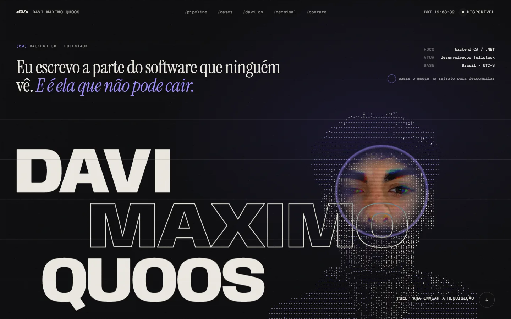

<br />

## O conceito

> **Este site é uma requisição HTTP.**
> Rolar a página é enviá-la. Ela atravessa cada camada de um backend e volta com `200 OK`.

Como desenvolvedor backend, a maior parte do que eu construo é invisível. Então, em vez de um portfólio que só *diz* isso, fiz um que *mostra*: o visitante acompanha um pacote saindo do navegador, passando por middleware, regras de negócio e banco de dados, e voltando como resposta.

```http
GET /davi HTTP/2
Accept: backend, fullstack, interfaces que fazem jus
```


<br />

## A requisição, camada por camada

A peça central é um túnel em WebGL guiado pela rolagem. Cada portal é uma camada da Clean Architecture, com uma forma própria, e o painel ao lado conta o que acontece ali e mede o tempo gasto como num trace real.

<table>
  <tr>
    <td width="50%">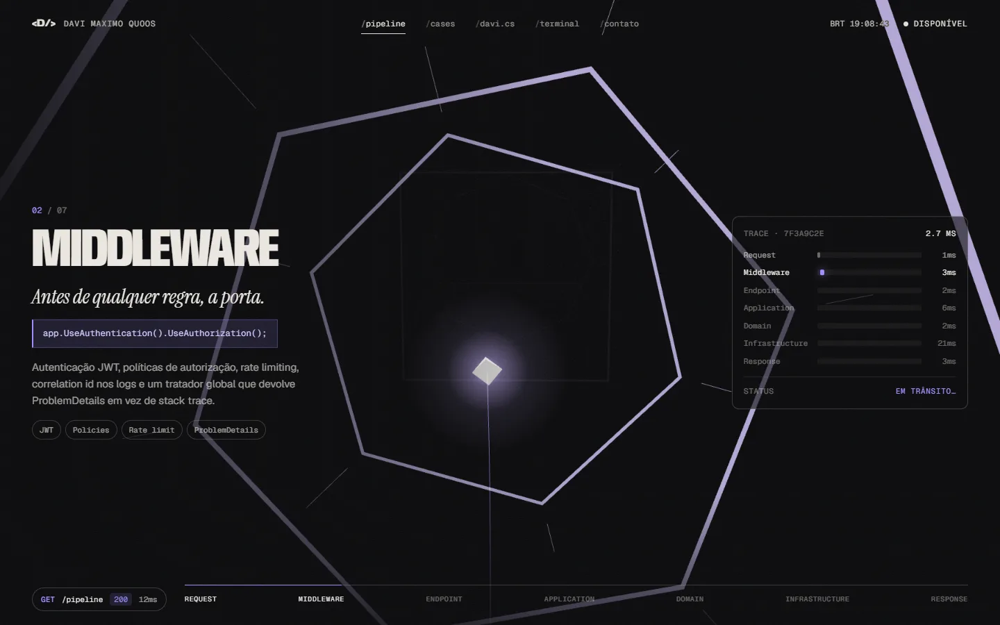</td>
    <td width="50%">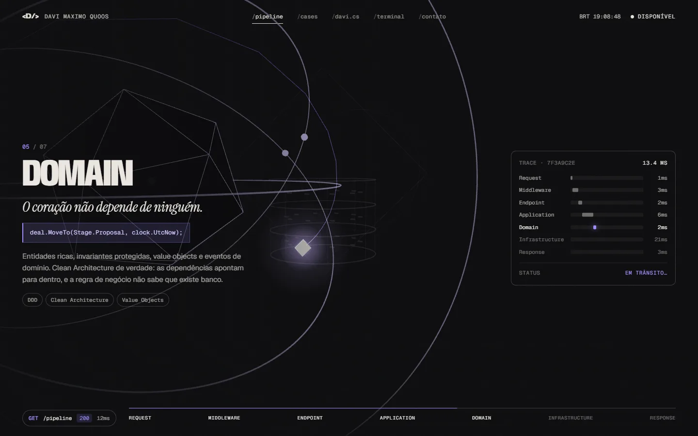</td>
  </tr>
  <tr>
    <td><sub><b>02 · Middleware</b> · autenticação, políticas e rate limit antes de qualquer regra</sub></td>
    <td><sub><b>05 · Domain</b> · o núcleo que não depende de ninguém; o pacote orbita as regras</sub></td>
  </tr>
  <tr>
    <td width="50%">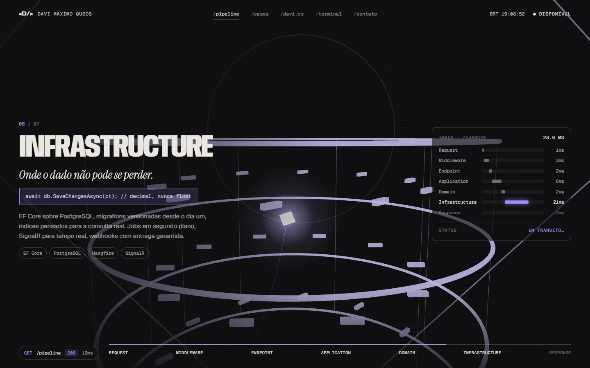</td>
    <td width="50%">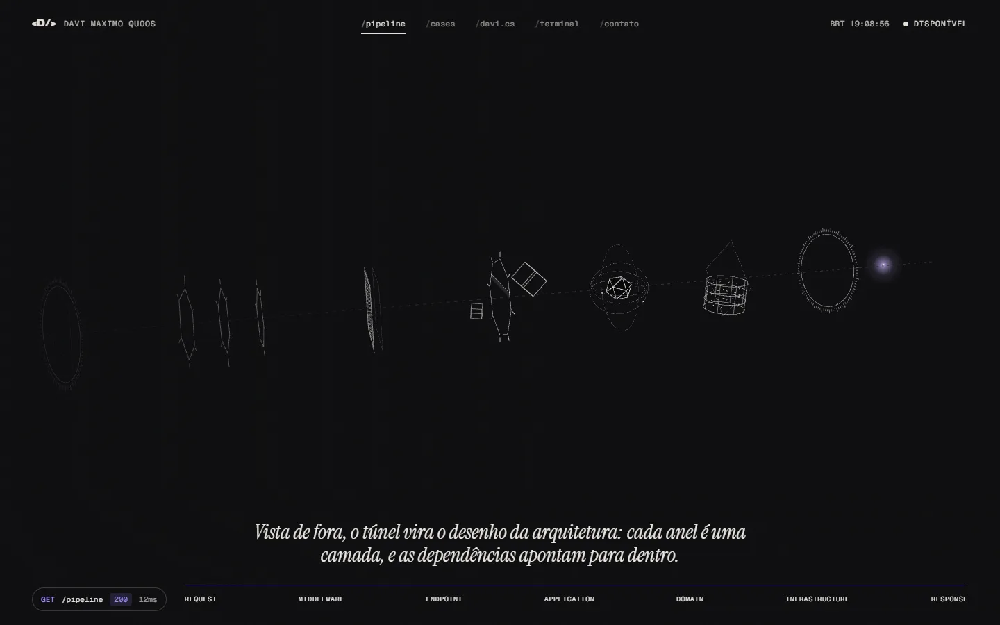</td>
  </tr>
  <tr>
    <td><sub><b>06 · Infrastructure</b> · o pacote mergulha no banco, onde o dado não pode se perder</sub></td>
    <td><sub><b>Vista de fora</b> · o túnel vira o desenho da arquitetura inteira</sub></td>
  </tr>
</table>

<br />

## O resto da resposta

<table>
  <tr>
    <td width="50%">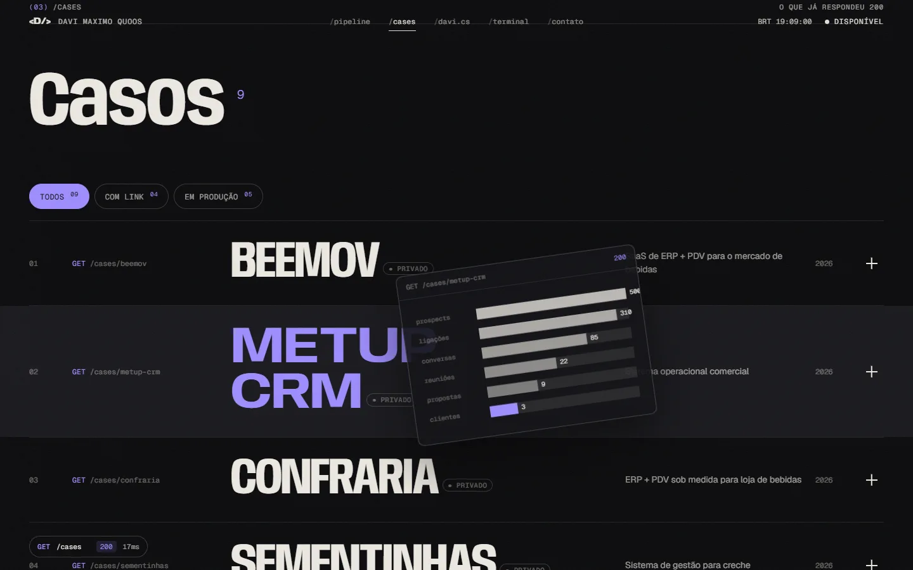</td>
    <td width="50%">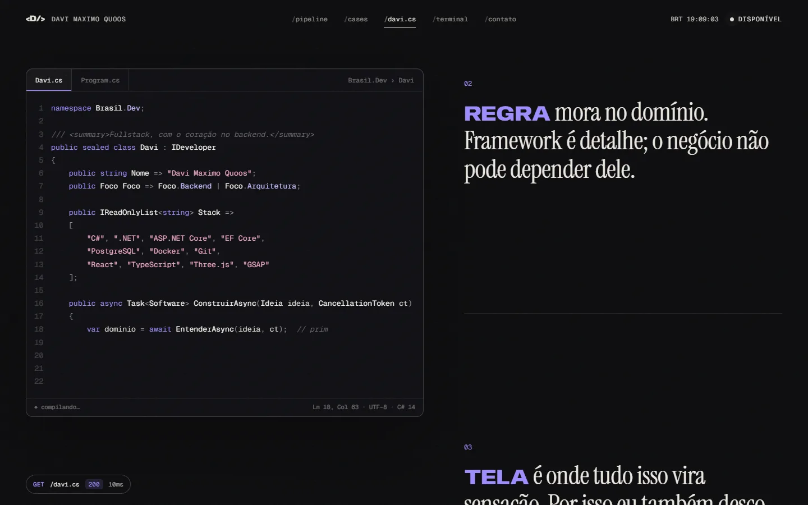</td>
  </tr>
  <tr>
    <td><sub><b>/cases</b> · cada projeto é uma rota, com visualização generativa própria no hover e filtro entre projetos públicos e sistemas em produção</sub></td>
    <td><sub><b>/davi.cs</b> · o "sobre mim" é uma classe C# digitada pela rolagem, com realce de sintaxe escrito do zero</sub></td>
  </tr>
  <tr>
    <td width="50%">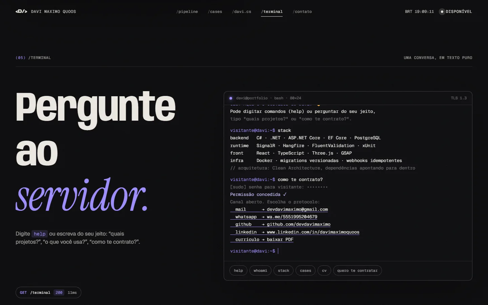</td>
    <td width="50%">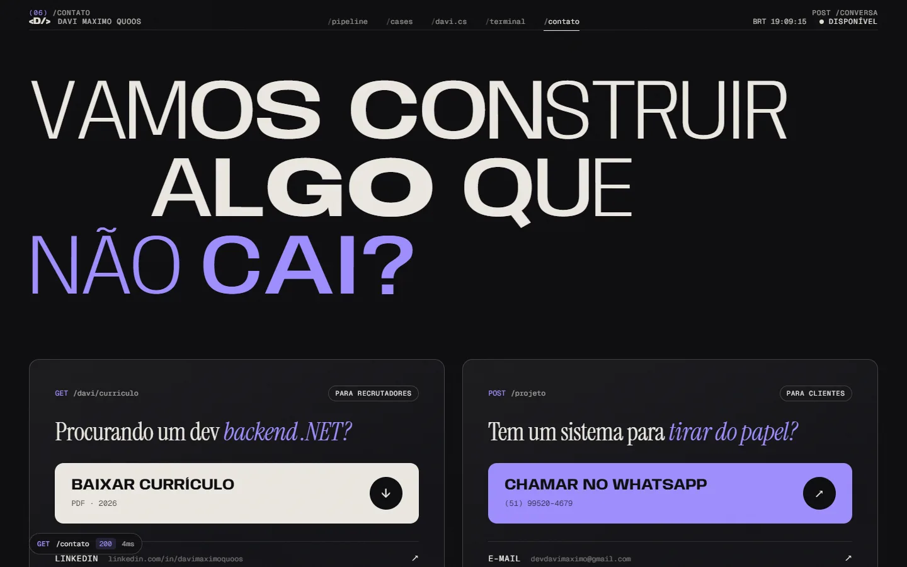</td>
  </tr>
  <tr>
    <td><sub><b>/terminal</b> · aceita comandos e perguntas em linguagem natural, com correção de digitação e alguns easter eggs</sub></td>
    <td><sub><b>/contato</b> · dois caminhos com o mesmo peso: currículo para recrutadores, WhatsApp para clientes</sub></td>
  </tr>
</table>

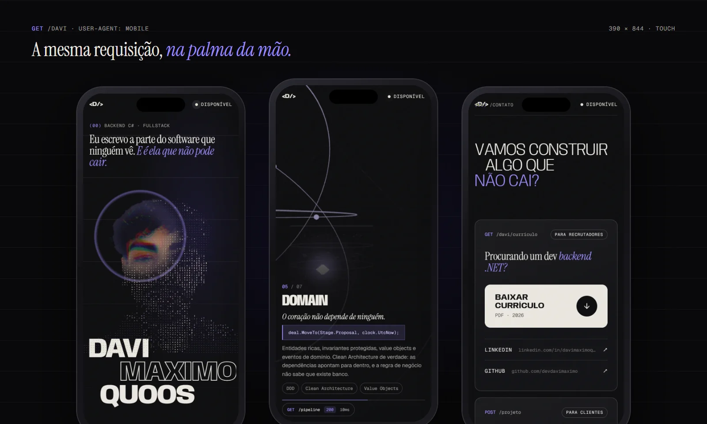

<br />

## Por baixo do capô

**Retrato em glifos.** Um único fragment shader desenha a foto como uma grade de caracteres. O atlas de glifos é montado no navegador e ordenado pela densidade real de tinta de cada caractere; o fundo é recortado por flood fill a partir das bordas, então brilhos no rosto não são confundidos com fundo. Perto do cursor a grade se desfaz e a foto real aparece, com aberração cromática e uma lente que se deforma com a velocidade do mouse.

**Túnel 3D.** React Three Fiber com geometria procedural: portais, membrana de pontos que ondula quando o pacote atravessa, poeira de dados e um rastro aditivo. A câmera persegue o pacote e, no fim, sai para uma vista lateral da arquitetura. O estado de rolagem chega ao WebGL por um objeto compartilhado, sem re-render do React.

**Tipografia viva.** O nome no hero, a faixa de tecnologias e o título do contato usam os eixos de largura e peso da Anybody. A entrada é guiada pela rolagem e o hover soma um acréscimo em variáveis separadas, então um nunca interrompe o outro.

**Terminal.** Um pequeno interpretador: comandos exatos, intenção em linguagem natural por expressões e sugestão por distância de Levenshtein quando algo é digitado errado.

### Performance

| Problema | Solução |
|---|---|
| three.js é pesado | Fica fora do bundle inicial; a abertura aparece na hora e espera o chunk carregar |
| Montar a cena 3D durante a rolagem causa engasgo | A cena é montada em tempo ocioso, com shaders pré-compilados e o primeiro quadro já desenhado |
| Aparelhos com GPU fraca | Resolução adaptativa: abaixo de ~45 fps a resolução interna cai em degraus e volta quando sobra fôlego |
| Elementos repetidos na cena | Instancing: os registros do banco viram 3 draw calls em vez de 30 |
| Efeitos de cursor forçando layout | Geometria em cache e cálculo uma vez por quadro; nenhuma leitura de layout durante o movimento |
| WebGL fora da tela | O loop de renderização pausa quando a seção sai da tela |
| Acessibilidade de movimento | `prefers-reduced-motion` desliga as animações pesadas |

<br />

## Stack

| Camada | Tecnologias |
|---|---|
| **Interface** | React 19, TypeScript, Vite |
| **3D** | Three.js, React Three Fiber, shaders GLSL próprios |
| **Movimento** | GSAP (ScrollTrigger, SplitText), Lenis |
| **Tipografia** | Anybody, Instrument Serif, Geist, Geist Mono |

## Rodando localmente

```bash
npm install
npm run dev      # desenvolvimento
npm run build    # checagem de tipos + build de produção em dist/
npm run preview  # serve o build
```

## Estrutura

```
src/
├─ components/   seções da página: Hero, Pipeline, Works, Source, Terminal, Contact
├─ gl/           WebGL: retrato em glifos, túnel 3D, shaders, resolução adaptativa
├─ lib/          rolagem, revelações, interpretador do terminal, realce de C#, prévias
├─ styles/       estilos globais e tokens de design
└─ content.ts    todo o conteúdo textual do site
```

<br />

<div align="center">

```http
HTTP/2 200 OK
x-developer: Davi Maximo Quoos
x-status: disponível para novos projetos
```

<a href="https://www.linkedin.com/in/davimaximoquoos">LinkedIn</a> ·
<a href="public/media/Davi_Maximo_Quoos_-_Curriculo_2026.pdf">Currículo</a> ·
<a href="mailto:devdavimaximo@gmail.com">devdavimaximo@gmail.com</a>

</div>
